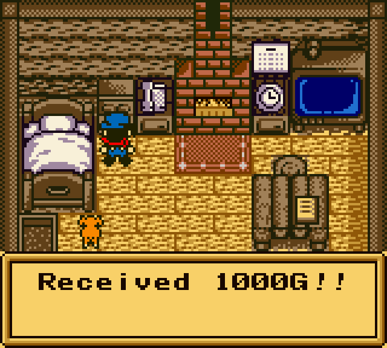

# Harvest Moon GBC: Grandpa’s Rainy Day Money

**Verified on the repository ROM:** On Spring 1 at 6 AM, immediately after the opening farm tour, inspecting the drawer directly to the right of the bed awarded **1,000G**. The balance went from **500G to 1,500G**. Inspecting it again on the same morning gave different dialogue and no second payout. No rain was needed.

## How to reproduce

1. Start a new game and advance through Grandpa’s introduction and the farm tour until you can move inside the starter farmhouse.
2. Press **Select** to see the starting balance of **500G**, then press **B** to close the status display.
3. Stand one tile below the drawer against the north wall, immediately right of the bed and left of the phone. Face **up** and press **A**. No tool was selected in the test.
4. Advance the dialogue with **A** until the game shows `Received 1000G!!`. Close that message and press **Select** again to see **1,500G**.
5. Close the status display with **B**, then press **A** at the same drawer. This time it says `Let me see...` followed by `Everything is alright!`. Close the dialogue and verify the balance is still **1,500G**.

## Screenshot evidence

Captured in order from a fresh, unmodified playthrough in PyBoy 2.9.0. Screenshots are emulator frames enlarged 4× with nearest-neighbor scaling.

| Step | Screenshot |
| --- | --- |
| ROM title screen (reads *Harvest Moon GB*) | [Title screen](00-title.png) |
| Spring 1, 6 AM, **500G** | [Starting balance](01-starting-balance.png) |
| Stand below the drawer, facing up | [Interaction position](02-drawer.png) |
| First inspection dialogue | [Discovery](03-discovery.png) · [“grandpa’s rainy”](04-rainy-day-dialogue.png) · [“day money?”](05-mines-now.png) |
| `Received 1000G!!` | [Reward message](06-reward.png) |
| Spring 1, 6 AM, **1,500G** | [Balance after payout](07-balance-after.png) |
| Second inspection: `Everything is alright!` | [Repeat dialogue](08-repeat-dialogue.png) · [Balance still 1,500G](09-repeat-balance.png) |

## After the first and second expansions

**House expansions neither remove nor reset the stash on this ROM.** This was tested in PyBoy 2.9.0 along two paths: leaving the stash unclaimed until each upgraded house was available (branching from a state before the Deluxe drawer was opened), and claiming it in the starter house before completing either expansion. To skip grinding, only the initial gold and lumber were seeded in emulator memory (30,000G and 700 materials). Both upgrades went through the Carpenter’s normal request, quote, and completion events. The drawer state, house level, and payouts shown below were not edited.

| Completed house | Where to press A | If unclaimed | If claimed in starter house |
| --- | --- | --- | --- |
| [Deluxe Wood House](expansions/deluxe-completion.png), Spring 6 | Left side of the house: stand below the drawer immediately right of the bed and left of the phone; face up. | [27,500G before](expansions/deluxe-before.png) → [Received 1000G!!](expansions/deluxe-reward.png) → [28,500G after](expansions/deluxe-after.png) | [“Everything is alright!”](expansions/deluxe-previously-claimed.png); balance stayed at 28,500G. |
| [Ultra-Deluxe Wood House](expansions/ultra-deluxe-completion.png), Spring 12 | The bed and drawer are now on the right side of the house. Stand below the drawer between the bed and the table; face up. | [22,500G before](expansions/ultra-deluxe-before.png) → [Received 1000G!!](expansions/ultra-deluxe-reward.png) → [23,500G after](expansions/ultra-deluxe-after.png) | [“Everything is alright!”](expansions/ultra-deluxe-previously-claimed.png); balance stayed at 23,500G. |

A second inspection after claiming the stash in either upgraded house also gave no additional gold. These tests contradict the guide’s advice to claim it before expanding, at least for this ROM. Cold boot/save reload was not tested.

## Randomizer implications

- **Use one location across all three layouts:** `Farmhouse: Grandpa’s Rainy Day Money`, with a vanilla reward of `1,000G`. Available after the intro; no house-upgrade cutoff is needed for this ROM.
- **Confirmed claim byte (this ROM):** Cartridge RAM bank 0 at `$B8FF` is `00` before claiming and `01` after. Separate scratch tests in the Ultra-Deluxe house confirmed that setting this byte alone to `01` skips the payout and clearing it to `00` restores the discovery and payout. Both the byte and stored gold (`$B8EF–$B8F1`, three-byte little-endian) updated by the first discovery dialogue, before the receipt screen. The earlier WRAM observations (`$CCCA–$CCCC` for displayed balance and `$CBF6` changing at receipt dismissal) are not reliable substitutes for the claim byte. A randomizer that replaces the vanilla reward should intercept the payout before the discovery dialogue, not when the player closes the receipt.

## Randomized ROM verification

The [local patcher](../../../README.md#generate-a-randomized-rom) rolls 1–1,000G once per seed, before you start playing. It patches both cartridge code paths and their receipt text without changing the claim logic. PyBoy 2.9.0 test results:

| Mode and house | Result |
| --- | --- |
| Game Boy Color, starter farmhouse (`kiwi-demo`) | [945G receipt](randomized/945g-receipt.png); 500G → [1,445G](randomized/1445g-balance.png) |
| Game Boy Color, Deluxe | [945G receipt](randomized/deluxe-945g-receipt.png); 27,500G → 28,445G |
| Game Boy Color, Ultra-Deluxe | [945G receipt](randomized/ultra-deluxe-945g-receipt.png); 22,500G → 23,445G |
| Game Boy (monochrome mode), starter farmhouse | [1G receipt](randomized/1g-dmg-receipt.png); 500G → 501G |
| Game Boy Color, starter farmhouse, upper bound | 1,000G; 500G → 1,500G, using output identical to the original ROM |

None of these tests paid again on a second inspection. The upgrade test runs used seeded gold and lumber as above. The ROM patch sets only the payout constant and receipt text in both copies, and updates the ROM-wide checksum.

## ROM and references

- Tested file: `Harvest Moon GB (USA) (SGB Enhanced).gbc` (SHA-256 `54fe95af5ded33631db84b6ba4ecc4a86f9f7528c9c56ca678150a3246d49623`). No other revision was tested.
- [Ushi No Tane — Tricks and Cheats](https://fogu.com/hm1/cheats.htm) identifies the dresser by the bed and the 1,000 reward.
- [IGN — Harvest Moon GBC Cheats](https://www.ign.com/wikis/gbc-cheats/Harvest_Moon_GBC_Cheats) lists the 1,000 reward in the cupboard at the start of the game.
- [Ranch Story — Hints and Tips](https://ranchstory.miraheze.org/wiki/Hints_and_Tips_(Harvest_Moon:_GB)) recommends checking the desk before expanding the house.
