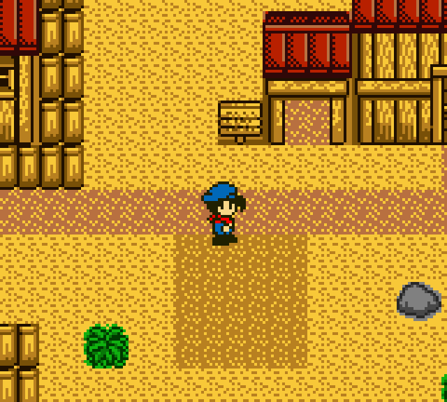
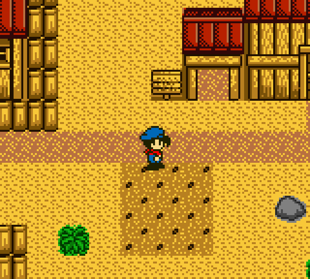
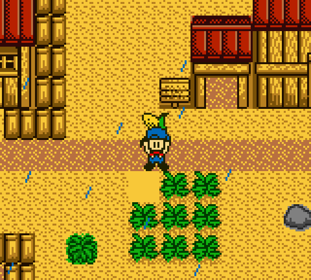
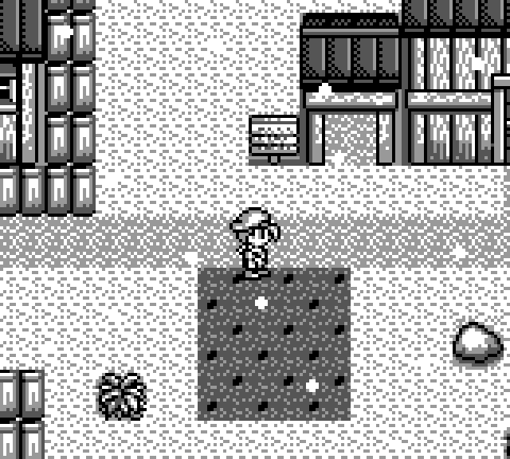
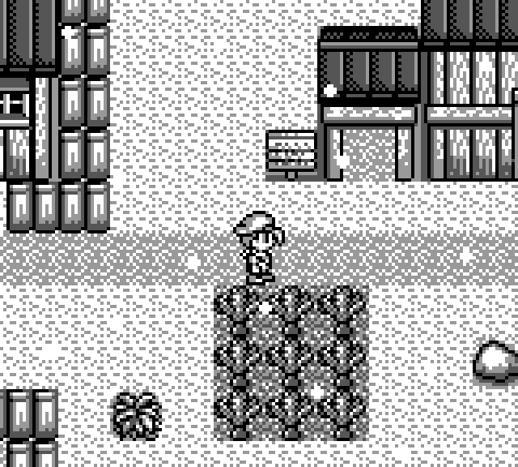
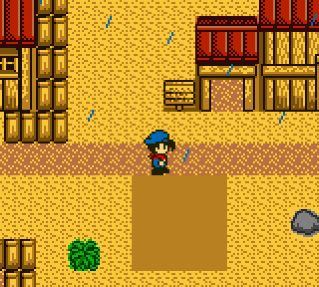
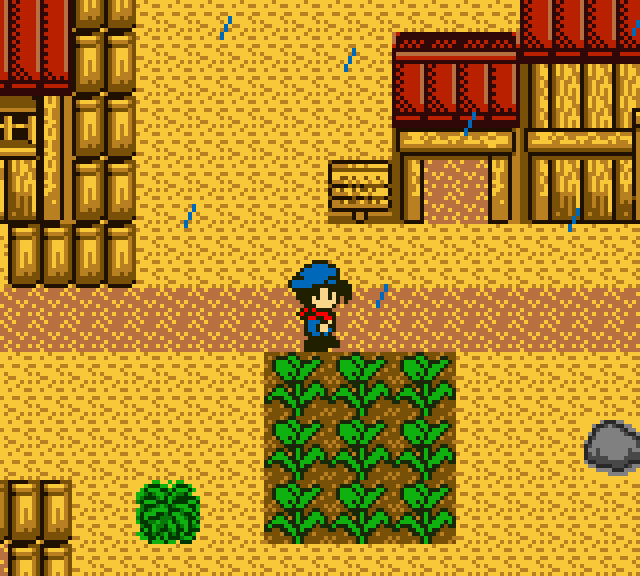
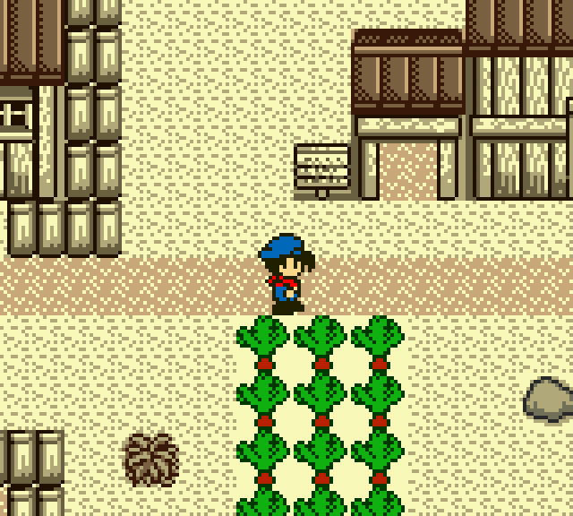
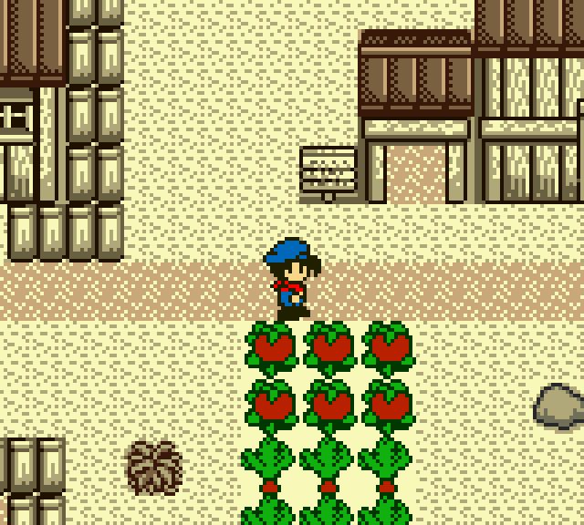

# Harvest Moon GB/GBC: Nina’s Flower Shop

Two independent, seeded checkboxes (both off by default):

- **Randomize seasonal seed stock** puts the eight crop seed types into four pairs. Each crop seed appears in exactly one season; the player’s name no longer filters randomized stock. Grass is included in Spring, Summer, and Fall, never Winter.
- **Shuffle seed shop slots** changes the counter order separately for each season, including the position of Grass where sold. On its own, it preserves the original seasonal inventory and the name-based Fall/Winter filters.

With seasonal stock randomized, **each crop grows in the season Nina sells it** instead of its vanilla season. Crops still need water, and leaving them planted into the wrong season can kill them. Prices, Grass behavior, and the original growth stages and harvest rules are unchanged. Slot shuffling on its own does not change growing seasons.

## Screenshot verification

Tested on the [supported USA ROM](../rainy-day-money/README.md#rom-and-references) in PyBoy 2.9.0, using seed **`nina-2`**, both shop options enabled, and the player name `AAA`. Each link shows the selected counter slot and its unmodified price. The season field was set before opening the shop from the same emulator state to avoid playing a full year. Stock, prices, and purchase logic were not edited in emulator memory.

| Season | Slot 1 | Slot 2 | Slot 3 |
| --- | --- | --- | --- |
| Spring | [Corn](spring-slot-1.png) | [Eggplant](spring-slot-2.png) | [Grass](spring-slot-3.png) |
| Summer | [Turnip](summer-slot-1.png) | [Grass](summer-slot-2.png) | [Peanut](summer-slot-3.png) |
| Fall | [Grass](fall-slot-1.png) | [Potato](fall-slot-2.png) | [Broccoli](fall-slot-3.png) |
| Winter | [Tomato](winter-slot-1.png) | [Carrot](winter-slot-2.png) | — |

- **Purchase check:** Bought [one bag of Corn in Spring for 300G](spring-corn-purchase.png). The actual balance fell from 500G to 200G, and Corn inventory increased from zero to one bag.
- **Game Boy mode:** All four inventories matched in monochrome mode, including [Winter’s two slots](winter-game-boy.png).
- **Options in isolation:** In a separate Fall check, slots-only gave Grass before Eggplant with `AAA` and Grass before Peanut with `aAA`. Stock-only offered Potato and Broccoli followed by Grass for both names.

## Overnight growth verification

PyBoy 2.9.0, seed **`nina-2`**, both shop options enabled. The old shop build and the fixed build sell the same seeds; the difference below is what the game does when the player sleeps.

### Spring Corn (Game Boy Color mode)

Nina [sells Corn in Spring](spring-slot-1.png) with this seed, even though vanilla Corn grows in Summer. The test equipped a Corn bag and set up nine tilled tiles using emulator memory. The player sowed the bag using the normal **A** action. Both runs started from that same planted field, with the top-middle tile watered, and used the normal bed prompt to advance from Spring 1 to Spring 2.

[Before bed: Corn sown](growing/spring-corn-sown.png) · [Date check: Spring 2](growing/spring-corn-date.png) · [After four rainy nights: seedlings](growing/spring-corn-sprouts.png)

| Old shop build: next morning | Fixed build: next morning | Fixed build: harvesting Corn |
| --- | --- | --- |
|  |  |  |

In the clear-weather comparison, the old build cleared all nine Corn tiles. The fixed build kept all nine and advanced the watered tile. In the harvest test, rain was controlled and the bed fixture was reloaded between overnight updates, carrying forward the actual crop tiles to avoid the unrelated Spring 10 horse cutscene. The crop reached maturity and was picked with **A**. The field test did not use a bag acquired in the separate shop purchase test.

### Winter Tomato (original Game Boy mode)

With `nina-2`, Tomato moves from Summer to Winter. This test set the season, snow forecast, and planted Tomato tiles in the emulator fixture, then ran the actual sleep routine. The fixed build kept the crop and snow watered it. Repeating the overnight update with the resulting tiles brought the crop to maturity.

| Old shop build: next morning | Fixed build: next morning | Fixed build: ripe Tomatoes |
| --- | --- | --- |
|  |  |  |

Separate overnight memory checks covered all eight crops in all four seasons in both hardware modes: the assigned crops survived, dry crops waited for water, manually watered crops advanced, rain or snow advanced in-season crops as appropriate, and out-of-season crops cleared.

## Crop graphics verification

In the build that first fixed crop survival, a reassigned crop could still look blank or use the sprite of a different crop. The farm loads seasonal graphics into shared tile slots, so a crop can be present in the save even when it is invisible on screen.

**Spring Corn, Game Boy Color mode:** With seed `nina-2`, both builds started from the same sown plot. The fixture was set to Year 2 to avoid the horse event, and rain was set before each sleep. After ten consecutive nights, the game recorded the same Corn growth stage on all nine tiles in both runs. Only the old build drew them as blank ground.

| Previous build: Corn looks blank | Graphics fix: the same Corn is visible |
| --- | --- |
|  |  |

The fixed build continued to [show ears on the ripe crop](graphics/spring-corn-ripe.png) and let the player [harvest an ear](graphics/spring-corn-harvest.png).

**Winter Tomato and Carrot:** These two crops normally share graphics slots. A controlled fixture with two rows of ripe Tomatoes above two rows of ripe Carrots rendered all four rows as Carrots on the previous build. The fixed build drew the two crops distinctly, including in [original Game Boy mode](graphics/winter-crops-game-boy.png).

| Previous build: both crops look like Carrots | Graphics fix: Tomatoes and Carrots are distinct |
| --- | --- |
|  |  |

PyBoy checks compared the loaded tile bitmaps for every stage of all eight crops in both hardware modes. Patch tests cover all 28 possible crop pairings. The fix loads the crop's original artwork while retaining the destination season's field colors, and does not change crop growth, shop assignments, or save data.

## ROM notes

The patch replaces the Flower Shop’s nine unrolled record calls with a dispatcher at file offsets `0x2491D` and `0xA4900`. It looks up the season (`$B884`) in a four-row inventory table, then feeds the selected records to the original shop builder. The item icons, names, prices, and transaction scripts still come from the original records. The shop’s active item count and five-byte records are visible from `$CD33` in WRAM. Only stock randomization relaxes the crop records’ original season/name filters; Grass retains its vanilla filter.

The same inventory rows drive the overnight crop season comparisons in both hardware modes. The weather check uses snow in Winter and rain in the other seasons. Neither the Grass handler nor the separate storm logic is patched.

The farm loader overlays the two assigned crops’ decoded vanilla bitmaps into the seasonal tileset on farm entry. Both the map/scroll renderer and the live tool-update renderer use matching metatile indexes, with spare slots for shared art indexes. The extra palette lookup is scoped to the farm. The overlay is only enabled with seasonal stock randomization.
